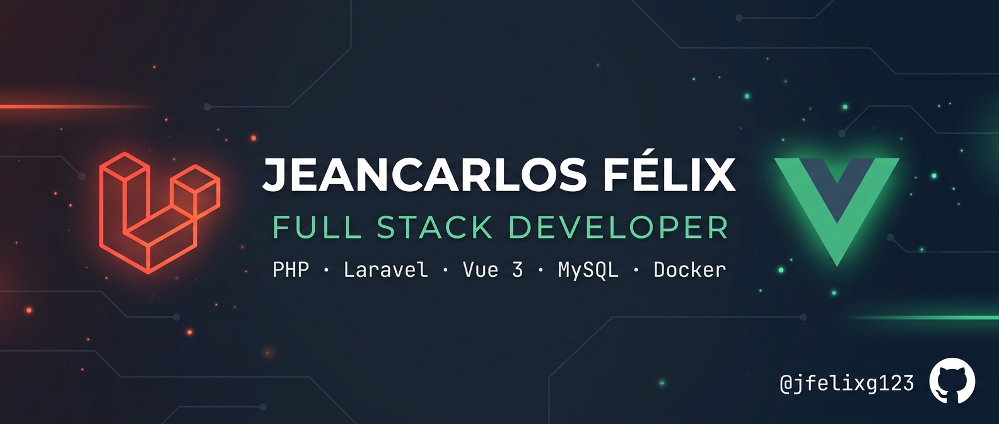

  

 #

## `$ whoami`

Desarrollo aplicaciones web con Laravel y Vue. En mis proyectos he trabajado
con APIs REST, bases de datos MySQL, integraciones de pago y despliegues con Docker.

## `$ ls proyectos/`

- **[Plataforma de torneos](https://github.com/jfelixg123/despliegue)** — Gestión de equipos, inscripciones y cuadros de competición con Laravel y Vue.
- **[ArenaSpot](https://github.com/jfelixg123/ArenaSpot)** — Plataforma de reservas para centros gaming con React, Express y Stripe.
- **[Routex2](https://github.com/jfelixg123/Routex2)** — Proyecto con procesamiento de datos en Apache Spark, visualización en Superset y automatización con n8n.

## `$ cat stack.md`

## `$ contact`

<!-- Añade aquí tu LinkedIn, portafolio o correo profesional. -->
