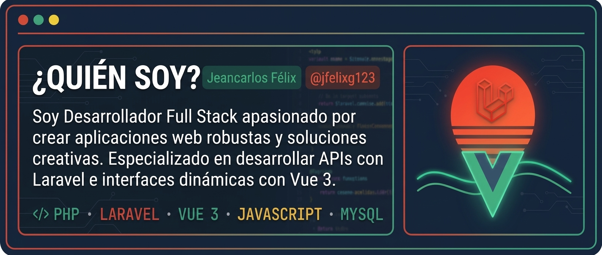

  
   
  
   

---

## `$ whoaim`

  

## `$ cat tech-stack.yaml`

<table>
  <thead>
    <tr>
      <th colspan="2" align="left"><code>jfelixg123:~$ cat tech-stack.yaml</code></th>
    </tr>
  </thead>
  <tbody>
    <tr>
      <td width="50%" align="center" valign="top">
        <strong>Backend</strong>  
        
         PHP · Laravel · Node.js · Express
      </td>
      <td width="50%" align="center" valign="top">
        <strong>Frontend</strong>  
        
         JavaScript · Vue · React · Tailwind CSS
      </td>
    </tr>
    <tr>
      <td align="center" valign="top">
        <strong>Bases de datos</strong>  
        
         MySQL · SQL Server
      </td>
      <td align="center" valign="top">
        <strong>Despliegue y control de versiones</strong>  
        
         Git · Docker · GitHub Actions
      </td>
    </tr>
    <tr>
      <td align="center" valign="top">
        <strong>Pagos y automatización</strong>  
        
        
      </td>
      <td align="center" valign="top">
        <strong>Procesamiento y visualización de datos</strong>  
        
        
      </td>
    </tr>
  </tbody>
</table>

---

## `$ connect --socials`

  

  
  
  

